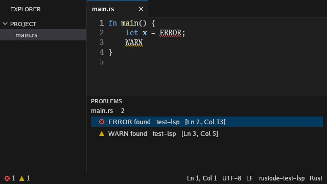
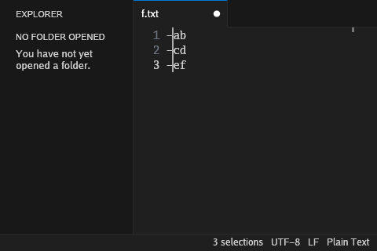
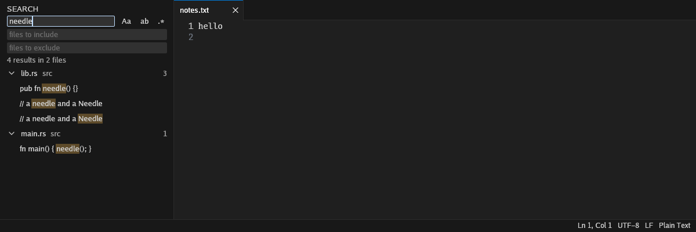
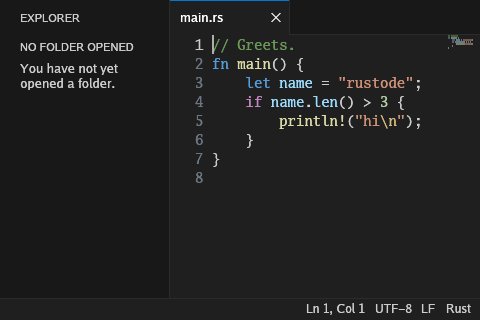
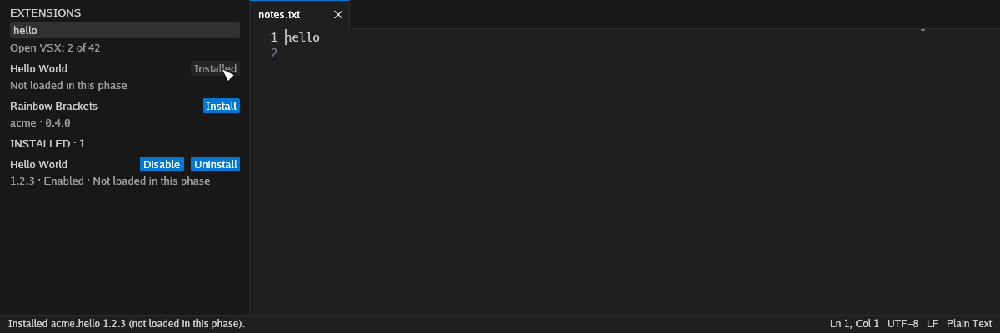

<h1 align="center">rustode</h1>

<p align="center">
  <strong>A code editor in Rust, measured against the VS Code it studies.</strong><br>
  One workspace engine, a terminal UI and a GUI, studied against a local build of VSCodium 1.147.0.
</p>

<p align="center">
  <a href="#license-and-credits"></a>
  
  
  <a href="#status"></a>
</p>

<p align="center">
  <br>
  <sub><em>The GUI with a language server's diagnostics. Every picture on this page is a snapshot test (<code>crates/gui/tests/snapshots/</code>), drawn by the code on <code>main</code>.</em></sub>
</p>

> [!NOTE]
> This repository holds two things: the **rustode editor** (`crates/`, `xtask/`) and the **study** of the VSCodium build it is measured against (`01-app/` to `09-analises/`). Everything in `01-app/` to `08-testes-do-build/` is a **real, read-only copy**, rebuilt by [`montar.sh`](montar.sh). The rules for both are in [`AGENTS.md`](AGENTS.md); the editor's are in its §11. rustode is not VS Code or VSCodium, and is not affiliated with either.

<p align="center">
  <a href="#edit">Edit</a> · <a href="#find-and-search">Search</a> · <a href="#syntax">Syntax</a> · <a href="#language-servers">Language servers</a> · <a href="#extensions">Extensions</a> · <a href="#two-frontends-one-workspace">Frontends</a> · <a href="#everything-is-a-command">Commands</a> · <a href="#the-study">The study</a> · <a href="#get-started">Get started</a> · <a href="#documentation">Docs</a> · <a href="#status">Status</a>
</p>

rustode behaves like the editor your hands already know: VS Code's command ids, default Linux keys, `settings.json` and `keybindings.json`, undo grouping, quick open scoring and Dark Modern colors. Underneath, it is new code: each behavior is studied in the exact source tree of the app next to it, reimplemented in Rust (never translated), credited in [`ATTRIBUTION.md`](ATTRIBUTION.md), and then measured against that app on the same virtual display.

<br>

## Edit

<p align="center">
  <br>
  <sub><em>Three cursors, one edit, one undo step.</em></sub>
</p>

**An editor core with no I/O.** `rustode-core` holds the text (a rope), the selections and the undo history; everything else talks to it through the workspace.

- **Undo like VS Code.** Typing groups into undo steps the way VS Code does, and undoing back to the saved version leaves the document clean. A property test checks that any sequence of edits followed by a full undo restores the text (`crates/workspace/tests/editing.rs`).
- **Multi-cursor.** Several selections, box selection that skips short lines, add cursor above or below, and `Ctrl+D` for the next occurrence.
- **Nothing lost on open and save.** Encodings (UTF-8 with or without a BOM, UTF-16 with a BOM, Windows-1252) and line endings (LF, CRLF, mixed) round-trip byte for byte. A save writes a temporary sibling and renames it over the file.
- **Files changed by other programs.** A clean document reloads as one undo step. A dirty one raises a conflict that you settle by reloading or by keeping your edits. A deleted file leaves the document open.
- **Large files.** In a release build, 1 GB opens in 2.29 s, and 10,000 random edits plus a full undo on 1 MB take 9 ms (`crates/workspace/tests/stress.rs`, measured on 2026-11-17).
- **Your settings, live.** `settings.json` and `keybindings.json` are read in VS Code's format, comments and trailing commas included. Problems are reported with a line and a column, never fatal. `when` clauses are evaluated, and `[language]` overrides apply.

## Find and search

<p align="center">
  <br>
  <sub><em>Find in Files: results stream in and can be cancelled at any time.</em></sub>
</p>

- **Find and replace** in the current file, with match case, whole word and regular expressions.
- **Find in Files** (`Ctrl+Shift+F`) searches the whole folder in the background and streams results in VS Code's order. It searches open documents with their unsaved edits.
  - It honors `.gitignore` and `.ignore`, `files.exclude` and `search.exclude`, and VS Code's glob syntax for include and exclude.
  - It skips binary files and stops at `search.maxResults`.
  - On 10,000 files and 1,000,000 lines, the first result arrives in 0.6 ms and a literal search finishes in 219 ms (release build, `crates/workspace/tests/search_stress.rs`; numbers from [#15](../../pull/15)).
- **Quick open** (`Ctrl+P`) ranks the folder's files with a reimplementation of VS Code's fuzzy scorer. **The command palette** (`Ctrl+Shift+P`, `F1`) lists commands with VS Code's ids, labels and keys. **Go to line** is `Ctrl+G`.

## Syntax

<p align="center">
  <br>
  <sub><em>Rust, highlighted by tree-sitter in Dark Modern's token colors.</em></sub>
</p>

- **Incremental.** Every text change, including undo, redo, reload and multi-cursor edits, is replayed on the tree-sitter tree before the reparse. A seam test runs 400 seeded random operations and checks after each step that the incremental tree equals a fresh parse (`crates/syntax/src/lib.rs`, `crates/workspace/tests/syntax.rs`).
- **Only what is on screen.** The workspace returns highlights for the requested lines only.
- **Large files.** As in VS Code, files over 20 MB or 300,000 lines are never highlighted.
- **Not yet:** languages other than Rust. A typed character on a 100,000-line file takes 34 ms, over the 16 ms frame budget ([#12](../../pull/12)).

## Language servers

- **Configured in `settings.json`.** One server runs per workspace root and language, started with the first document of that language. Document sync is incremental or full, whichever the server asks for. Positions are converted line by line between UTF-8, UTF-16 and UTF-32.
- **Diagnostics everywhere.**
  - In the editor: squiggles in the GUI, and colored underlines with gutter marks in the TUI.
  - A problems panel (`Ctrl+Shift+M`).
  - Error and warning counts in the status bar.
- **A crash is survivable.** A server whose output ends is restarted up to four times in three minutes, then stays down until you run "Language Server: Restart". Editing carries on throughout.
- **Tested without the network.** The tests use `rustode-test-lsp`, a scripted server that is never shipped (`crates/test-lsp`).
- **Not yet:** hover, completion, go to definition, references, rename and format.

## Extensions

<p align="center">
  <br>
  <sub><em>Extensions from Open VSX, kept in VS Code's on-disk format.</em></sub>
</p>

- **Open VSX only.** You can search, install, uninstall, enable, disable and list extensions.
  - Microsoft Marketplace hosts are refused at every URL and every redirect.
  - An install needs a published SHA-256, and the download must match it. Zip-slip is refused, and a failed install leaves nothing behind.
- **VS Code's format.** The extension folders, `extensions.json`, `package.json` field order and the disabled-extensions storage row all match what the App writes. A later extension host needs no migration.
- **Not loaded in this phase.** Phase 1 manages extensions; it does not run them. Every installed row says so.

## Two frontends, one workspace

```text
rustode-tui PATH...     the terminal editor (ratatui)
rustode-gui PATH...     the GUI (egui), with AccessKit and the Go fonts
rustode bench …         a versioned benchmark scenario, on rustode and on a verified copy of the App
```

- **The same features in both.**
  - Tabs, the explorer, search, problems and extensions. Quick open, the palette and find are in the TUI, and in review for the GUI ([#16](../../pull/16)).
  - Mouse support, and focus that moves between parts with `F6`.
  - Width bands for narrow windows or terminals.
- **The TUI degrades gracefully.**
  - Colors fall back from 24-bit to 256, then 16, then none (`NO_COLOR`).
  - Control and bidirectional characters are drawn visibly.
  - Key to frame takes p99 0.88 ms on ratatui's test backend.
- **The GUI scales.** It renders at 100–200% with HiDPI-aligned pixels, and the keyboard reaches every part.
- **No logic in a frontend.** Frontends depend on no rustode crate but `rustode-workspace`, and a test enforces it (`xtask/tests/frontend_deps.rs`).

## Everything is a command

Every action has a stable id: VS Code's, when one exists. The palette, keybindings, tests and any future automation all reach an action through that id:

```rust
workspace.execute("workbench.action.files.save")?;
workspace.execute_with("workbench.extensions.installExtension", "acme.hello")?;
```

The registry is `COMMANDS` in `crates/workspace/src/commands.rs`. How commands, layers, positions and versions fit together is in [`AGENTS.md`](AGENTS.md) §11.7, "Design rules".

<br>

## The study

rustode is measured against a local build of **VSCodium 1.147.0**:
- VS Code at commit `22d8dccf0f29`;
- the VSCodium `ca7f7b44b5e5` patches, ported from 1.143.1;
- Electron 43.8.6 (Chromium 150, Node 24.22.1), as a `codium` binary for Linux x64.

The repository keeps the built app, **the exact source tree that produced it**, the patches and the QA runs. The source tree is the reference for every behavior rustode reimplements ([ADR 0004](docs/adr/0004-arvore-fonte-e-a-referencia.md)).

**What the study found so far:**

| Finding | Evidence |
|---|---|
| No Microsoft service is contacted. The only hosts are Open VSX, the Eclipse Foundation's malicious-extension list (GitHub) and Electron's spell-checker dictionary (Google) | [`09-analises/0001`](09-analises/0001-trafego-de-rede.md) |
| AI ships turned off (`chat.disableAIFeatures: true`), which also hides the MCP commands | patch `00-copilot-fix-action-condition` |
| Without a recorded commit, the agent host looks for modules in `node_modules` instead of `node_modules.asar.unpacked` | [`docs/aprendizado/0001`](docs/aprendizado/0001-commit-muda-caminho-dos-modulos.md) |
| Keystrokes can be injected on the virtual display through libei or `org_kde_kwin_fake_input`; `zwp_virtual_keyboard_v1` is not offered | [`09-analises/0002`](09-analises/0002-entrada-virtual-wayland.md) |
| The built app starts faster than the 1.138 reference: workbench ready at p50 1905 ms against 2232 ms (10 repetitions, same virtual display) | [`08-testes-do-build/`](08-testes-do-build/RESUMO.md) |

**Patches:** 55 applied: 32 VSCodium patches unchanged, 19 adapted to 1.147, and 4 exclusive to the port (96 to 99). Another 6 were skipped because they only serve other architectures ([`docs/patches.md`](docs/patches.md), [`06-port/PORT-NOTES.md`](06-port/PORT-NOTES.md)). **Processes and bundles:** [`docs/arquitetura.md`](docs/arquitetura.md). **How the build was made:** `06-port/` runs `apply.sh` → `install.sh` → `finish.sh` → `build.sh`, under a memory cap ([`docs/build.md`](docs/build.md)).

<details>
<summary><strong>Folders of the study</strong></summary>

| Folder | Contents |
|---|---|
| `01-app/VSCode-linux-x64/` | the packaged app: the `codium` binary and `resources/app` (`out/`, `node_modules.asar`, 93 extensions) |
| `03-documentos/` | QA documents, port notes, VSCodium documentation and network reports |
| `04-fotos/` | every test screenshot |
| `05-qa/` | the QA project: `docs/`, `suite/`, `results/` and its git history |
| `06-port/` | the port scripts, original and adapted patches, and the logs |
| `07-vscodium-origem/` | the VSCodium the port started from |
| `08-testes-do-build/` | the test runs on the built app (from 2026-11-16 on), with `RESUMO.md` |
| `09-analises/` | **this project's findings**, the only study folder written here |

Every file in 01 to 08 is a real copy, with no symbolic or hard links. What each artifact is for is in [`AGENTS.md`](AGENTS.md) §10.

</details>

<br>

## Get started

You need Rust (the toolchain is pinned in `rust-toolchain.toml`) and a C compiler for tree-sitter. Then:

```sh
cargo run --release -p rustode-tui -- .       # the terminal editor, on this folder
cargo run --release -p rustode-gui -- .       # the GUI
cargo run --release -p rustode-cli -- --help  # the `rustode` CLI and `rustode bench`
cargo nextest run --workspace                 # the test suite
```

Settings live in `$XDG_CONFIG_HOME/rustode/User/` (override with `RUSTODE_USER_DIR`), never in a VS Code profile. Before your first commit, install the hooks once: `pre-commit install --hook-type pre-commit --hook-type commit-msg --hook-type pre-push`. The conventions they check are in [`CONTRIBUTING.md`](CONTRIBUTING.md).

## Documentation

| | |
|---|---|
| [`AGENTS.md`](AGENTS.md) | the rules for agents and contributors: evidence, licenses, privacy, running the app, and the editor's rules and design rules (§11) |
| [`CONTRIBUTING.md`](CONTRIBUTING.md) | commits, branches and checks; what runs when; the review checklist |
| [`ROADMAP.md`](ROADMAP.md) | milestones M0–M9, key numbers, the Gap Analysis against VS Code, the progress log |
| [`docs/adr/`](docs/adr/) | decisions: the study's (0001–0006) and the editor's (0007 on) |
| [`docs/arquitetura.md`](docs/arquitetura.md) · [`docs/fonte-vs-pacote.md`](docs/fonte-vs-pacote.md) | the app's processes and layers · the origin of each packaged file |
| [`docs/build.md`](docs/build.md) · [`docs/patches.md`](docs/patches.md) · [`docs/qa.md`](docs/qa.md) | how the app was built · every patch · test results |
| [`docs/lacunas.md`](docs/lacunas.md) · [`docs/glossario.md`](docs/glossario.md) | open questions (G1…) · project terms |
| [`docs/modelos/`](docs/modelos/) · [`docs/aprendizado/`](docs/aprendizado/) | document templates · reusable lessons |
| [`ATTRIBUTION.md`](ATTRIBUTION.md) · [`NOTICE`](NOTICE) | provenance, the behavior studied and reimplemented, the editor's dependencies |

## Status

rustode is young. It edits, searches and shows diagnostics today, and it is not ready to replace your editor yet.

**Phase 1 has ten milestones** ([ADR 0018](docs/adr/0018-phase-1-milestones.md)). On `main`:

- **M1, core and CLI:** done except the CLI's `open` command. The micro-benchmark gate runs on every pull request ([#11](../../pull/11)).
- **M2, workspace and TUI:** its listed scope is complete.
- **M3, GUI:** tabs, the explorer, the status bar, width bands, HiDPI and keyboard focus are merged ([#3](../../pull/3), [#8](../../pull/8), [#14](../../pull/14)). The palette, quick open and find are in review ([#16](../../pull/16)). The first like-for-like benchmark against the App comes with M3.
- **M4–M8:**
  - started: Rust highlighting ([#12](../../pull/12)), language-server diagnostics ([#10](../../pull/10)), workspace search ([#15](../../pull/15)), extension management ([#9](../../pull/9), [#13](../../pull/13));
  - not started: debugging (M7).
- **M9, the Phase 1 report:** not started.

**Two numbers to watch.** Each was measured in its pull request, in a debug build, on 2026-11-18:
- **Tests:** 408 pass, with 5 large stress cases skipped (at [#15](../../pull/15)).
- **Line coverage:** 93.9% on the core crates and 87.4% on the frontends, against gates of 85% and 60%.

[`ROADMAP.md`](ROADMAP.md) has every number with the command that produced it.

**The biggest gaps today:**
- **No like-for-like comparison with the App yet.** The one benchmark run so far compares in-process open with a cold app launch.
- **Only Rust is highlighted.** Typing in a 100,000-line file misses the frame budget.
- **Language servers show diagnostics only.** Hover, completion and navigation are missing.
- **No debugger, no split editors, no hot exit.**
- **The design rules' gaps** (`AGENTS.md` §11.7, "not applied yet"), for example:
  - no `catch_unwind` per command or per frame;
  - no fsync before a save's rename;
  - no parser mutation tests.

## Architecture

A layered Cargo workspace. Each crate may depend only on a layer below its own:

| Layer | Crates |
|---|---|
| L0 | `rustode-core`: text, selections, edits, undo; no I/O |
| L1 | `rustode-syntax` · `rustode-fs` · `rustode-config` · `rustode-trace` · `rustode-protocol` |
| L2 | `rustode-workspace`: **the single API for every frontend**: documents, commands, search, language servers, extensions |
| L3 | `rustode-cli` · `rustode-tui` · `rustode-gui` |
| tools | `xtask` (hooks, coverage, the benchmark gate) · `rustode-test-lsp` |

The same checks run on every commit and in CI ([ADR 0023](docs/adr/0023-same-checks-local-and-ci.md)):
- formatting;
- clippy pedantic with warnings denied (`unsafe` is forbidden);
- the test suite;
- gitleaks and semgrep;
- `cargo deny`;
- the commit conventions.

CI also runs the coverage gates and `cargo audit`, and, on pull requests, the 10% micro-benchmark gate.

## License and credits

The editor is MIT, as declared in `Cargo.toml` ([ADR 0009](docs/adr/0009-mit-and-reimplemented-behavior.md)). Its dependencies and their licenses are in [`ATTRIBUTION.md`](ATTRIBUTION.md), checked by `cargo deny`. The GUI bundles the Go fonts (BSD-3-Clause). The `LICENSE` file and the license of the analysis documents are still the owner's decision.

**Clean-room.** rustode reimplements behavior; it does not copy code. Each behavior is studied in the source tree, rewritten, and credited in `ATTRIBUTION.md`, in the file's doc comment and in the component's ADR. Microsoft's proprietary extensions and the Microsoft Marketplace are out of scope.

The analyzed material keeps its own licenses: Code - OSS, VSCodium and Electron are MIT, and Chromium and the other dependencies use free licenses ([`NOTICE`](NOTICE)). "Visual Studio Code" and "VS Code" are Microsoft trademarks, and "VSCodium" belongs to the VSCodium project. This project is not affiliated with any of them.

> [!WARNING]
> `05-qa/results/backup-sharedStorage-125048.vscdb` contains the owner's personal folder and file paths. Don't read it or share it ([`AGENTS.md`](AGENTS.md) §2.1).
